# Brightdesk complete SVG asset gallery

**These are the actual source assets copied from Brightdesk's product repositories and shared identity files.** Every preview below opens the exact SVG stored in this repository.

This gallery contains **48 SVG files** in five collections: 2 identity marks, 10 product application icons, 10 workspace previews, 10 social banners and 16 documentation diagrams.

## Brightdesk identity (2)

<table>
<thead><tr><th>Asset</th><th>Preview — click to open</th><th>Direct file</th></tr></thead>
<tbody>
<tr><td><strong>Brightdesk wordmark</strong></td><td></td><td><a href="assets/branding/brightdesk-logo.svg">Open SVG</a></td></tr>
<tr><td><strong>Brightdesk mark</strong></td><td></td><td><a href="assets/branding/brightdesk-mark.svg">Open SVG</a></td></tr>
</tbody>
</table>

## Actual product application icons (10)

These are copied unchanged from the corresponding product repositories' icon files.

<table>
<thead><tr><th>Product</th><th>Icon — click to open</th><th>Direct file</th></tr></thead>
<tbody>
<tr><td><strong>Pages</strong></td><td></td><td><a href="assets/product-icons/pages.svg">Open Pages icon SVG</a></td></tr>
<tr><td><strong>Sheets</strong></td><td></td><td><a href="assets/product-icons/sheets.svg">Open Sheets icon SVG</a></td></tr>
<tr><td><strong>Decks</strong></td><td></td><td><a href="assets/product-icons/decks.svg">Open Decks icon SVG</a></td></tr>
<tr><td><strong>Notes</strong></td><td></td><td><a href="assets/product-icons/notes.svg">Open Notes icon SVG</a></td></tr>
<tr><td><strong>Database</strong></td><td></td><td><a href="assets/product-icons/database.svg">Open Database icon SVG</a></td></tr>
<tr><td><strong>Forms</strong></td><td></td><td><a href="assets/product-icons/forms.svg">Open Forms icon SVG</a></td></tr>
<tr><td><strong>Lists</strong></td><td></td><td><a href="assets/product-icons/lists.svg">Open Lists icon SVG</a></td></tr>
<tr><td><strong>Planner</strong></td><td></td><td><a href="assets/product-icons/planner.svg">Open Planner icon SVG</a></td></tr>
<tr><td><strong>To Do</strong></td><td></td><td><a href="assets/product-icons/todo.svg">Open To Do icon SVG</a></td></tr>
<tr><td><strong>Workspace</strong></td><td></td><td><a href="assets/product-icons/workspace.svg">Open Workspace icon SVG</a></td></tr>
</tbody>
</table>

## Product workspace previews (10)

These are the product-specific workspace previews from the source repositories. Some are explicitly labelled design previews or proposed concepts. **They are not verified screenshots of running software.**

<table>
<thead><tr><th>Product</th><th>Preview — click to open</th><th>Direct file</th></tr></thead>
<tbody>
<tr><td><strong>Pages</strong></td><td></td><td><a href="assets/product-previews/pages.svg">Open Pages workspace SVG</a></td></tr>
<tr><td><strong>Sheets</strong></td><td></td><td><a href="assets/product-previews/sheets.svg">Open Sheets workspace SVG</a></td></tr>
<tr><td><strong>Decks</strong></td><td></td><td><a href="assets/product-previews/decks.svg">Open Decks workspace SVG</a></td></tr>
<tr><td><strong>Notes</strong></td><td><a href="assets/product-previews/notes.svg">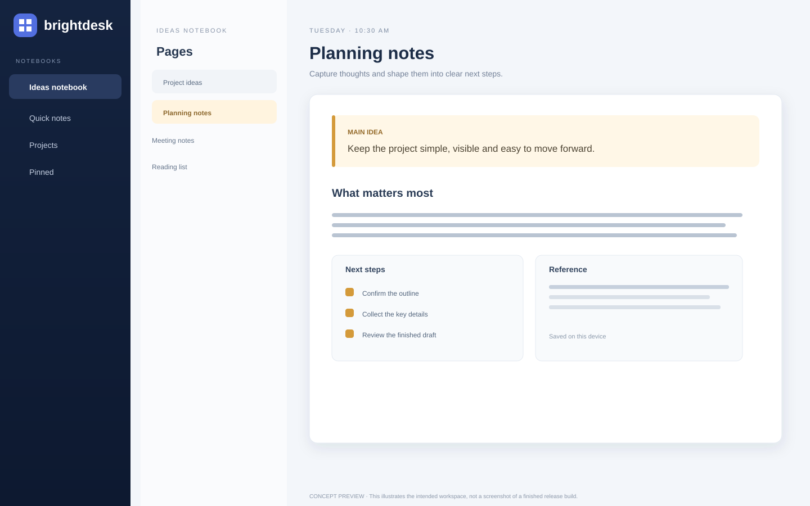</a></td><td><a href="assets/product-previews/notes.svg">Open Notes workspace SVG</a></td></tr>
<tr><td><strong>Database</strong></td><td></td><td><a href="assets/product-previews/database.svg">Open Database workspace SVG</a></td></tr>
<tr><td><strong>Forms</strong></td><td><a href="assets/product-previews/forms.svg">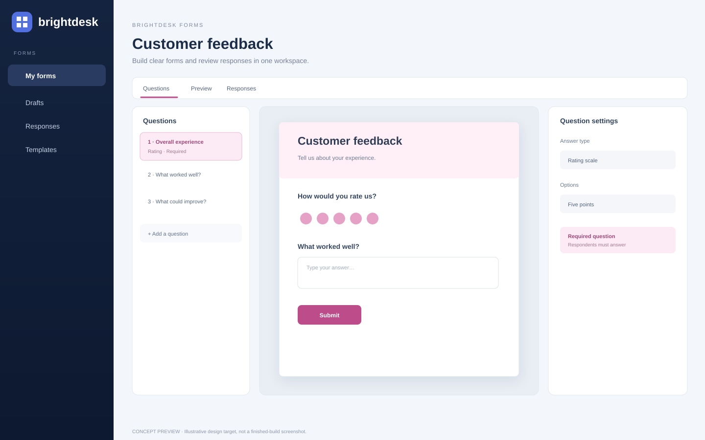</a></td><td><a href="assets/product-previews/forms.svg">Open Forms workspace SVG</a></td></tr>
<tr><td><strong>Lists</strong></td><td></td><td><a href="assets/product-previews/lists.svg">Open Lists workspace SVG</a></td></tr>
<tr><td><strong>Planner</strong></td><td></td><td><a href="assets/product-previews/planner.svg">Open Planner workspace SVG</a></td></tr>
<tr><td><strong>To Do</strong></td><td><a href="assets/product-previews/todo.svg">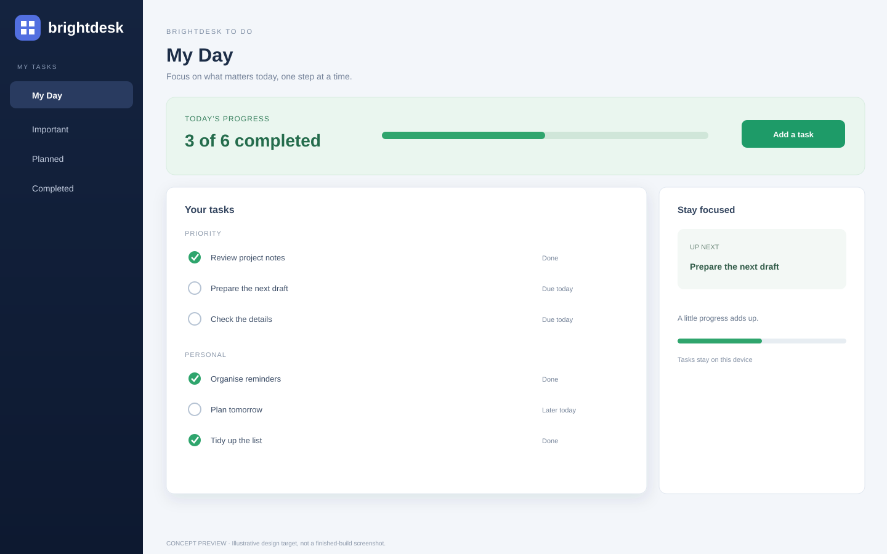</a></td><td><a href="assets/product-previews/todo.svg">Open To Do workspace SVG</a></td></tr>
<tr><td><strong>Workspace</strong></td><td></td><td><a href="assets/product-previews/workspace.svg">Open Workspace workspace SVG</a></td></tr>
</tbody>
</table>

## Product social banners (10)

These are the original product-specific social/metadata preview banners copied from the source repositories.

<table>
<thead><tr><th>Product</th><th>Preview — click to open</th><th>Direct file</th></tr></thead>
<tbody>
<tr><td><strong>Pages</strong></td><td></td><td><a href="assets/social-previews/pages.svg">Open Pages social banner SVG</a></td></tr>
<tr><td><strong>Sheets</strong></td><td><a href="assets/social-previews/sheets.svg">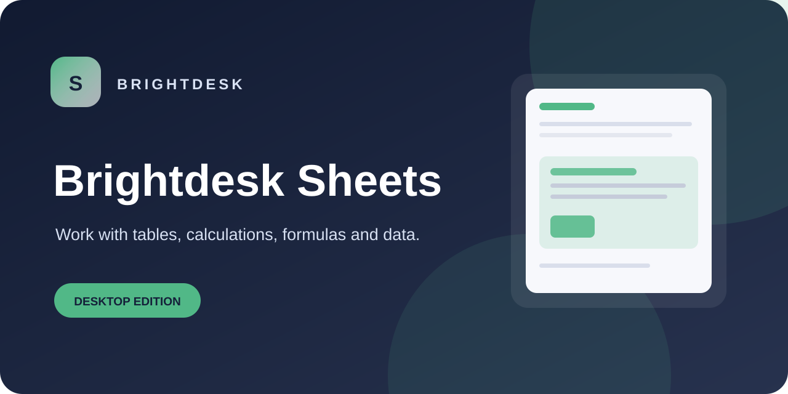</a></td><td><a href="assets/social-previews/sheets.svg">Open Sheets social banner SVG</a></td></tr>
<tr><td><strong>Decks</strong></td><td><a href="assets/social-previews/decks.svg">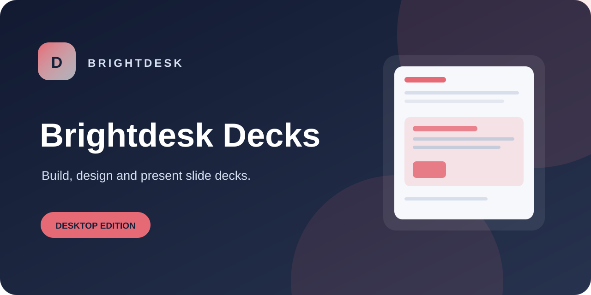</a></td><td><a href="assets/social-previews/decks.svg">Open Decks social banner SVG</a></td></tr>
<tr><td><strong>Notes</strong></td><td><a href="assets/social-previews/notes.svg">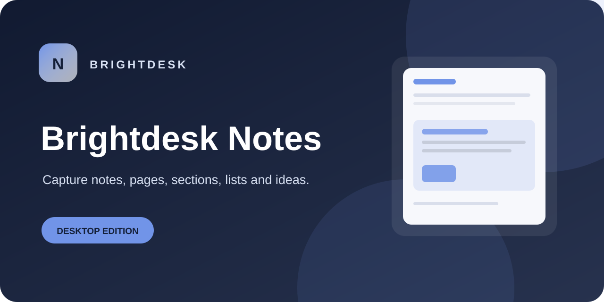</a></td><td><a href="assets/social-previews/notes.svg">Open Notes social banner SVG</a></td></tr>
<tr><td><strong>Database</strong></td><td><a href="assets/social-previews/database.svg">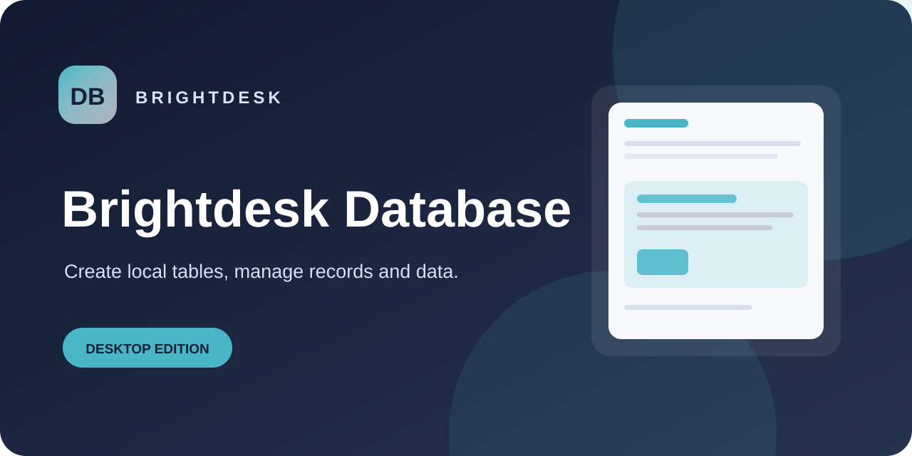</a></td><td><a href="assets/social-previews/database.svg">Open Database social banner SVG</a></td></tr>
<tr><td><strong>Forms</strong></td><td><a href="assets/social-previews/forms.svg">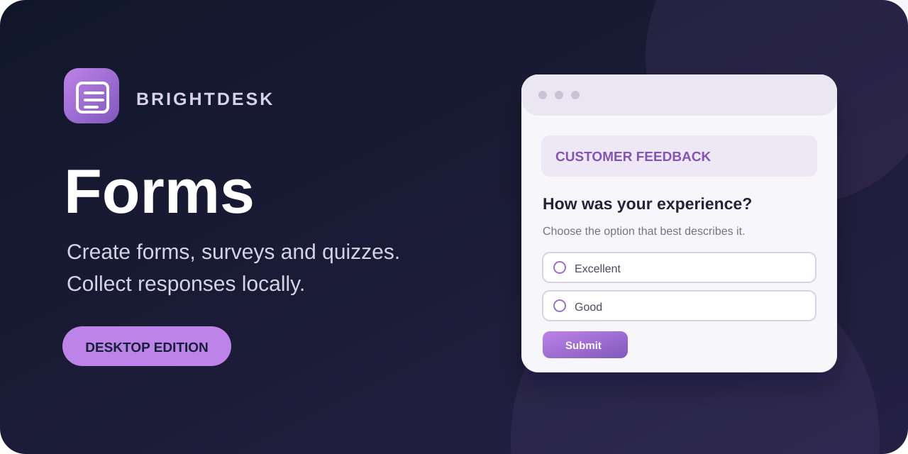</a></td><td><a href="assets/social-previews/forms.svg">Open Forms social banner SVG</a></td></tr>
<tr><td><strong>Lists</strong></td><td><a href="assets/social-previews/lists.svg">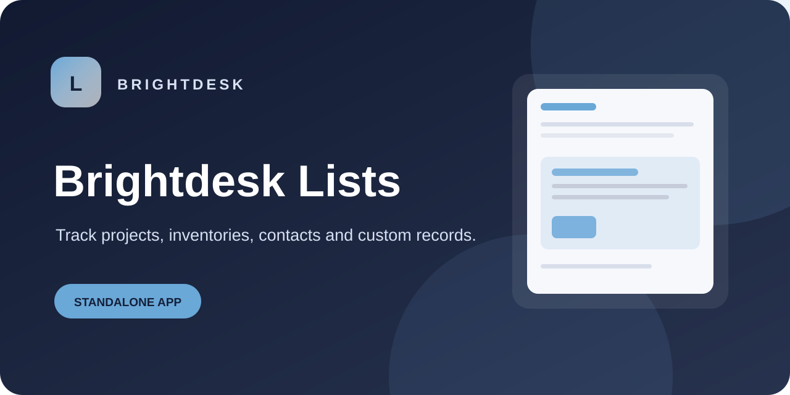</a></td><td><a href="assets/social-previews/lists.svg">Open Lists social banner SVG</a></td></tr>
<tr><td><strong>Planner</strong></td><td></td><td><a href="assets/social-previews/planner.svg">Open Planner social banner SVG</a></td></tr>
<tr><td><strong>To Do</strong></td><td><a href="assets/social-previews/todo.svg">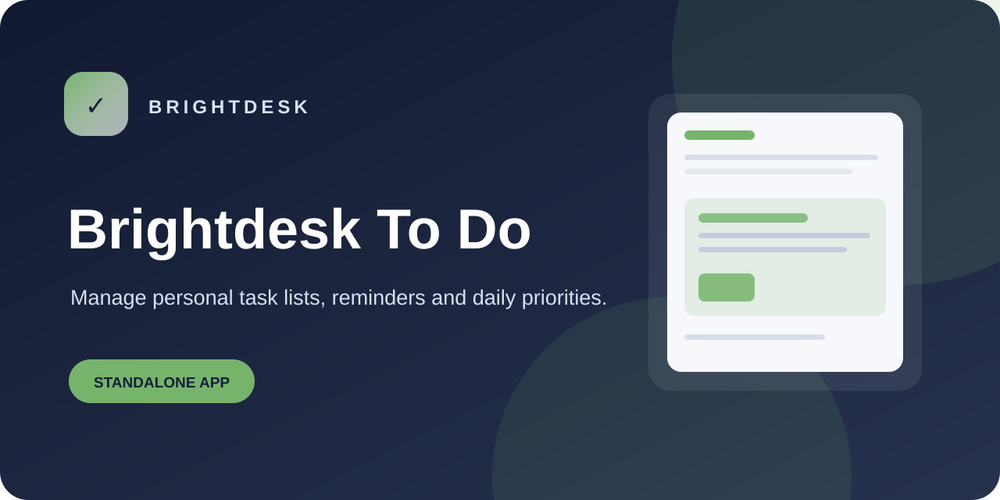</a></td><td><a href="assets/social-previews/todo.svg">Open To Do social banner SVG</a></td></tr>
<tr><td><strong>Workspace</strong></td><td><a href="assets/social-previews/workspace.svg">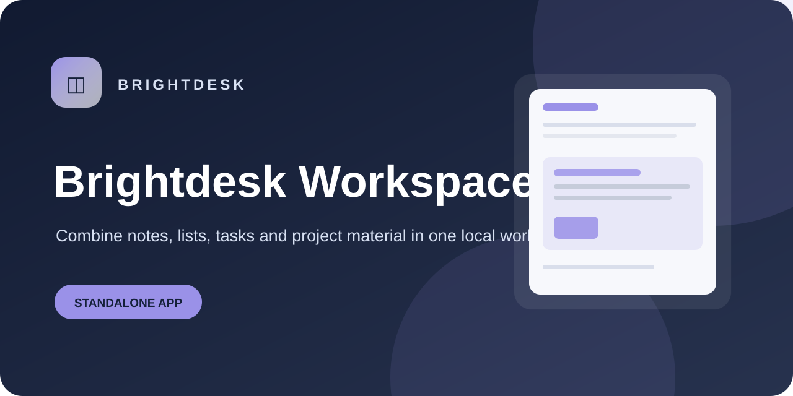</a></td><td><a href="assets/social-previews/workspace.svg">Open Workspace social banner SVG</a></td></tr>
</tbody>
</table>

## Documentation diagrams (16)

These are helpful illustrations for asset governance, screenshots and product help. They remain documentation, not product screenshots or distributable customer artwork.

<table>
<thead><tr><th>Diagram</th><th>Preview — click to open</th><th>Direct file</th></tr></thead>
<tbody>
<tr><td><strong>Product guide — Database</strong></td><td></td><td><a href="docs/media/guide-database.svg">Open SVG</a></td></tr>
<tr><td><strong>Product guide — Decks</strong></td><td></td><td><a href="docs/media/guide-decks.svg">Open SVG</a></td></tr>
<tr><td><strong>Product guide — Forms</strong></td><td></td><td><a href="docs/media/guide-forms.svg">Open SVG</a></td></tr>
<tr><td><strong>Product guide — Lists</strong></td><td></td><td><a href="docs/media/guide-lists.svg">Open SVG</a></td></tr>
<tr><td><strong>Product guide — Notes</strong></td><td></td><td><a href="docs/media/guide-notes.svg">Open SVG</a></td></tr>
<tr><td><strong>Product guide — Pages</strong></td><td></td><td><a href="docs/media/guide-pages.svg">Open SVG</a></td></tr>
<tr><td><strong>Product guide — Planner</strong></td><td></td><td><a href="docs/media/guide-planner.svg">Open SVG</a></td></tr>
<tr><td><strong>Product guide — Sheets</strong></td><td></td><td><a href="docs/media/guide-sheets.svg">Open SVG</a></td></tr>
<tr><td><strong>Product guide — To Do</strong></td><td><a href="docs/media/guide-to-do.svg">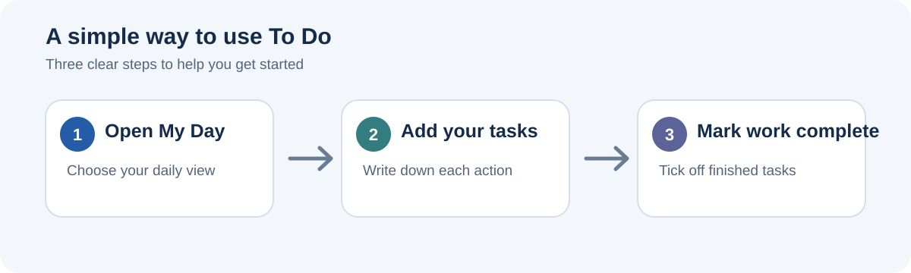</a></td><td><a href="docs/media/guide-to-do.svg">Open SVG</a></td></tr>
<tr><td><strong>Product guide — Workspace</strong></td><td></td><td><a href="docs/media/guide-workspace.svg">Open SVG</a></td></tr>
<tr><td><strong>Asset approval pipeline</strong></td><td></td><td><a href="docs/media/asset-approval-pipeline.svg">Open SVG</a></td></tr>
<tr><td><strong>Asset library blueprint</strong></td><td><a href="docs/media/asset-library-blueprint.svg">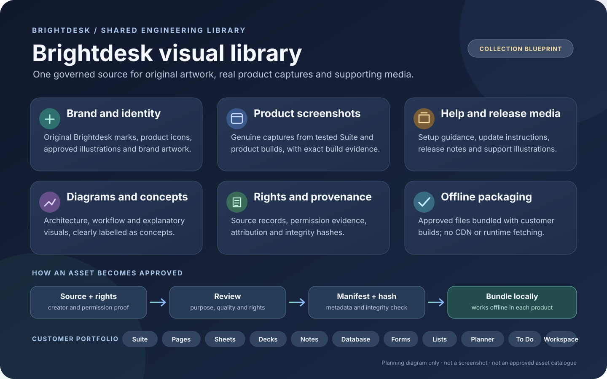</a></td><td><a href="docs/media/asset-library-blueprint.svg">Open SVG</a></td></tr>
<tr><td><strong>Offline asset delivery</strong></td><td></td><td><a href="docs/media/offline-asset-delivery.svg">Open SVG</a></td></tr>
<tr><td><strong>Screenshot coverage plan</strong></td><td><a href="docs/media/screenshot-coverage-plan.svg">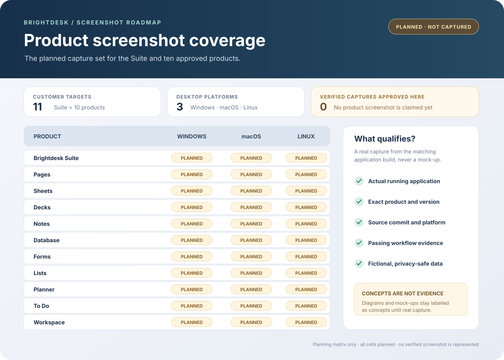</a></td><td><a href="docs/media/screenshot-coverage-plan.svg">Open SVG</a></td></tr>
<tr><td><strong>Screenshot evidence template</strong></td><td></td><td><a href="docs/media/screenshot-evidence-template.svg">Open SVG</a></td></tr>
<tr><td><strong>Visual review checklist</strong></td><td></td><td><a href="docs/media/visual-review-checklist.svg">Open SVG</a></td></tr>
</tbody>
</table>

## Source and distribution records

- [Source-mirrored asset catalog](docs/source-asset-catalog.md) records the original repository, source path and source Git blob SHA for every mirrored product/brand file.
- [Asset governance](docs/asset-governance.md) explains approval and packaging requirements.
- [Approved asset manifest](assets/manifest.json) remains the only distribution approval registry.

**Screenshot status:** There are still no verified screenshots captured from the actual running Suite or products. Genuine screenshots must be captured from a tested build and linked to its exact version, commit and successful workflow evidence. Workspace previews above must not be substituted for those captures.
