# Brightdesk complete SVG asset gallery

**Browse, preview and open every SVG currently stored on the `main` branch.**

This page indexes **36 SVG files**. Select any preview or its direct link to open the original SVG in GitHub.

> **Please note:** Product icon and interface visuals are concept artwork, not screenshots of running products and not approved final icons. Product guide and library diagrams are explanatory documentation. None of these files is currently approved for customer distribution or registered in `assets/manifest.json`.

## Product icon concepts (10)

Original icon directions for the ten approved Brightdesk customer products.

<table>
<thead><tr><th>Product</th><th>Preview — click to open</th><th>File</th></tr></thead>
<tbody>
<tr><td><strong>Pages</strong></td><td></td><td><a href="assets/concepts/product-icons/pages.svg">Open SVG</a></td></tr>
<tr><td><strong>Sheets</strong></td><td></td><td><a href="assets/concepts/product-icons/sheets.svg">Open SVG</a></td></tr>
<tr><td><strong>Decks</strong></td><td></td><td><a href="assets/concepts/product-icons/decks.svg">Open SVG</a></td></tr>
<tr><td><strong>Notes</strong></td><td></td><td><a href="assets/concepts/product-icons/notes.svg">Open SVG</a></td></tr>
<tr><td><strong>Database</strong></td><td></td><td><a href="assets/concepts/product-icons/database.svg">Open SVG</a></td></tr>
<tr><td><strong>Forms</strong></td><td></td><td><a href="assets/concepts/product-icons/forms.svg">Open SVG</a></td></tr>
<tr><td><strong>Lists</strong></td><td></td><td><a href="assets/concepts/product-icons/lists.svg">Open SVG</a></td></tr>
<tr><td><strong>Planner</strong></td><td></td><td><a href="assets/concepts/product-icons/planner.svg">Open SVG</a></td></tr>
<tr><td><strong>To Do</strong></td><td></td><td><a href="assets/concepts/product-icons/todo.svg">Open SVG</a></td></tr>
<tr><td><strong>Workspace</strong></td><td></td><td><a href="assets/concepts/product-icons/workspace.svg">Open SVG</a></td></tr>
</tbody>
</table>

Guide: [Product icon concepts](assets/concepts/product-icons/README.md).

## Product-interface illustration concepts (10)

Larger interface compositions for the ten approved products. These are visual concepts, not captures from running applications.

<table>
<thead><tr><th>Product</th><th>Preview — click to open</th><th>File</th></tr></thead>
<tbody>
<tr><td><strong>Pages</strong></td><td><a href="assets/concepts/product-illustrations/pages.svg">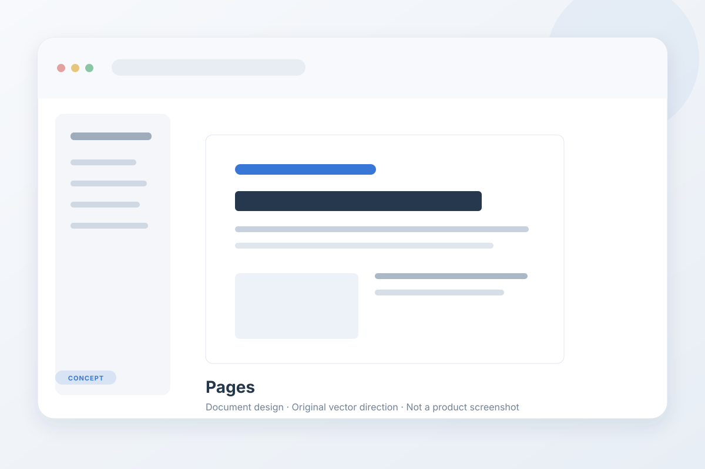</a></td><td><a href="assets/concepts/product-illustrations/pages.svg">Open SVG</a></td></tr>
<tr><td><strong>Sheets</strong></td><td><a href="assets/concepts/product-illustrations/sheets.svg">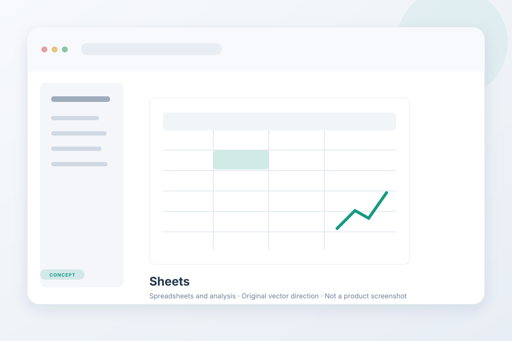</a></td><td><a href="assets/concepts/product-illustrations/sheets.svg">Open SVG</a></td></tr>
<tr><td><strong>Decks</strong></td><td><a href="assets/concepts/product-illustrations/decks.svg">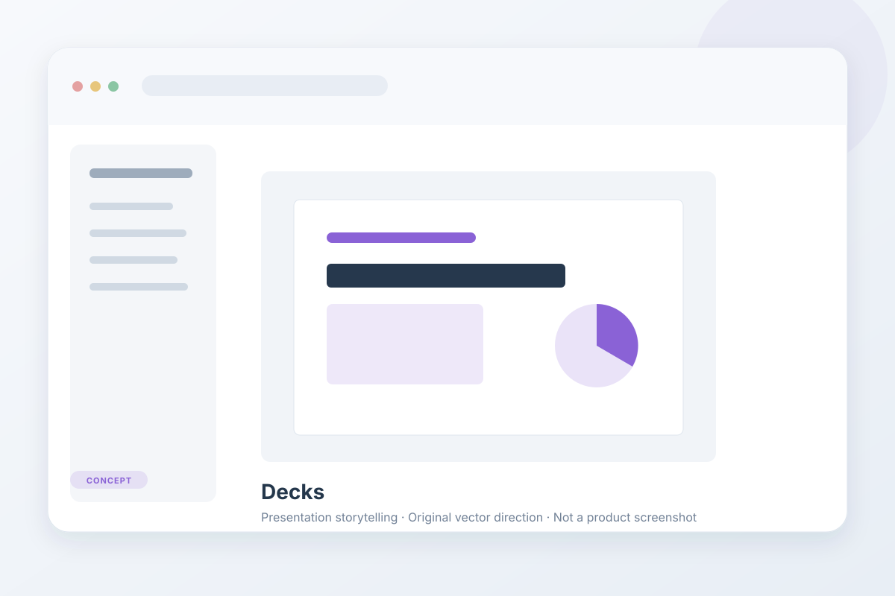</a></td><td><a href="assets/concepts/product-illustrations/decks.svg">Open SVG</a></td></tr>
<tr><td><strong>Notes</strong></td><td><a href="assets/concepts/product-illustrations/notes.svg">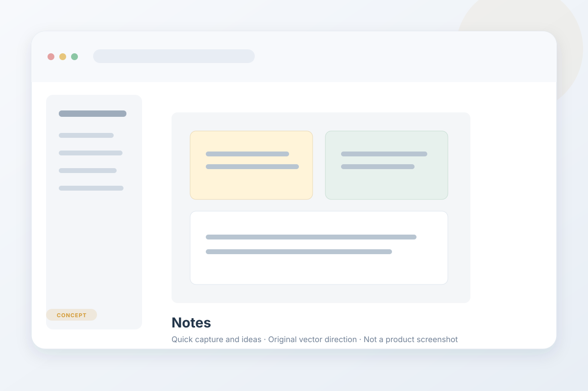</a></td><td><a href="assets/concepts/product-illustrations/notes.svg">Open SVG</a></td></tr>
<tr><td><strong>Database</strong></td><td><a href="assets/concepts/product-illustrations/database.svg">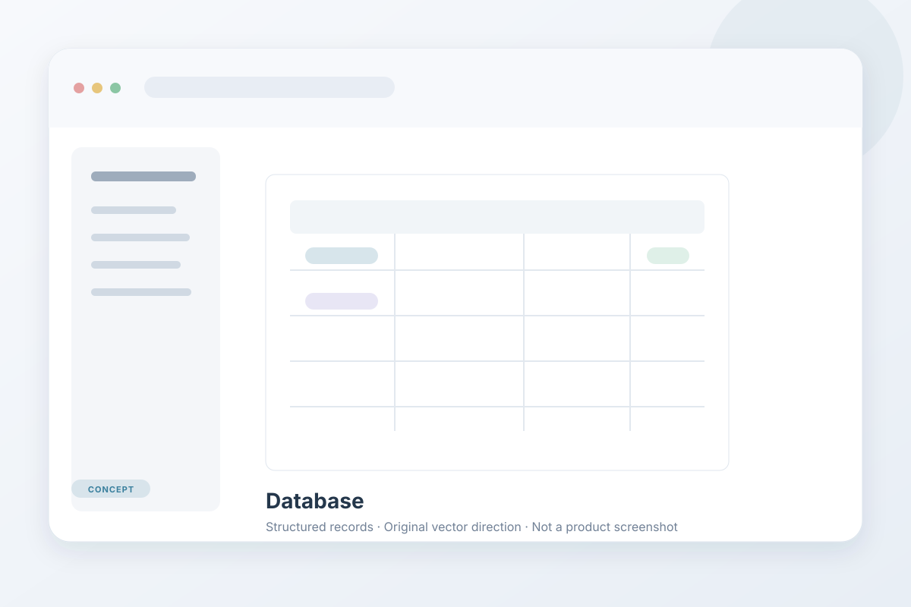</a></td><td><a href="assets/concepts/product-illustrations/database.svg">Open SVG</a></td></tr>
<tr><td><strong>Forms</strong></td><td><a href="assets/concepts/product-illustrations/forms.svg">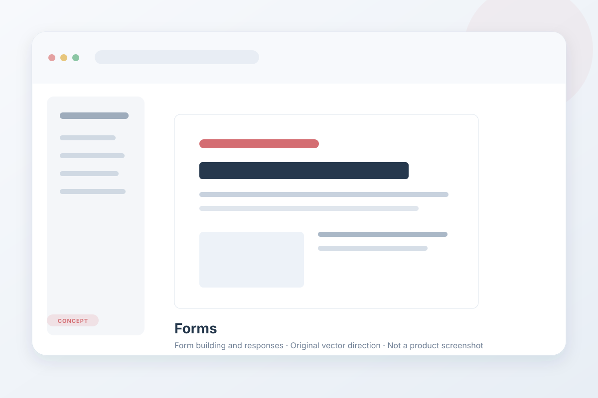</a></td><td><a href="assets/concepts/product-illustrations/forms.svg">Open SVG</a></td></tr>
<tr><td><strong>Lists</strong></td><td><a href="assets/concepts/product-illustrations/lists.svg">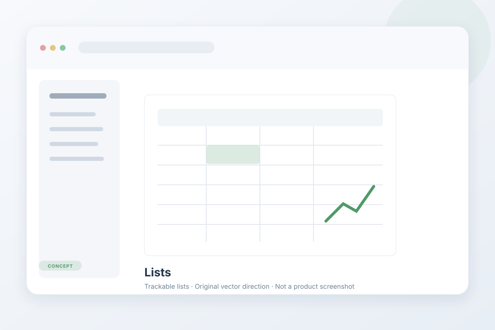</a></td><td><a href="assets/concepts/product-illustrations/lists.svg">Open SVG</a></td></tr>
<tr><td><strong>Planner</strong></td><td><a href="assets/concepts/product-illustrations/planner.svg">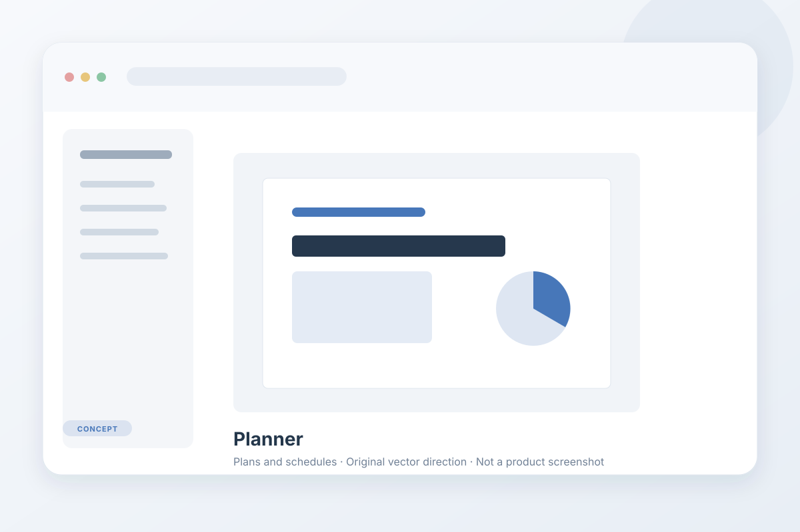</a></td><td><a href="assets/concepts/product-illustrations/planner.svg">Open SVG</a></td></tr>
<tr><td><strong>To Do</strong></td><td><a href="assets/concepts/product-illustrations/todo.svg">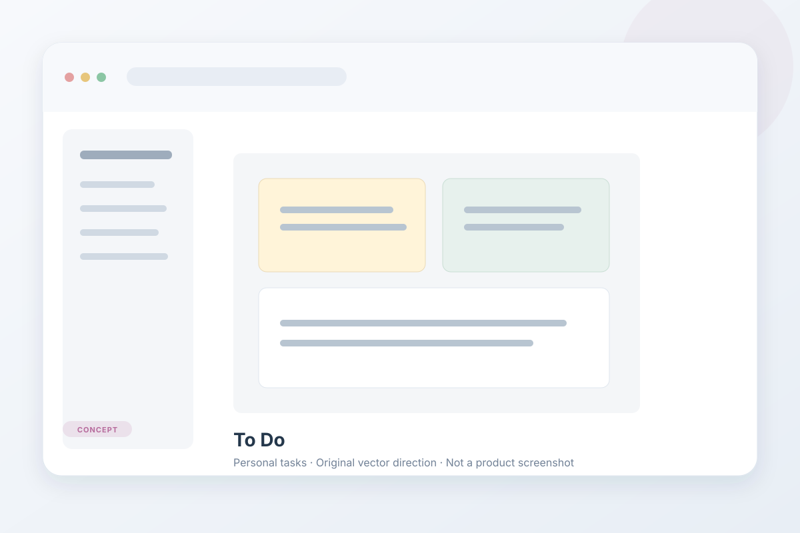</a></td><td><a href="assets/concepts/product-illustrations/todo.svg">Open SVG</a></td></tr>
<tr><td><strong>Workspace</strong></td><td><a href="assets/concepts/product-illustrations/workspace.svg">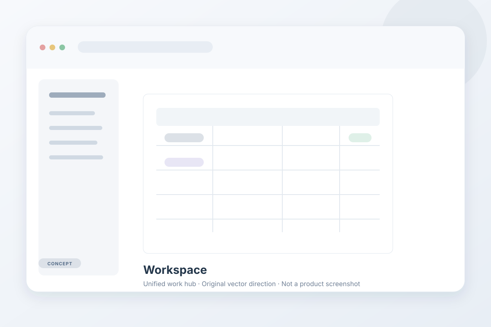</a></td><td><a href="assets/concepts/product-illustrations/workspace.svg">Open SVG</a></td></tr>
</tbody>
</table>

Guide: [Product illustration concepts](assets/concepts/README.md).

## Product guide diagrams (10)

These original diagrams support the product documentation and help explain individual product workflows and guidance.

<table>
<thead><tr><th>Guide</th><th>Preview — click to open</th><th>File</th></tr></thead>
<tbody>
<tr><td><strong>Database — product guide diagram</strong></td><td><a href="docs/media/guide-database.svg">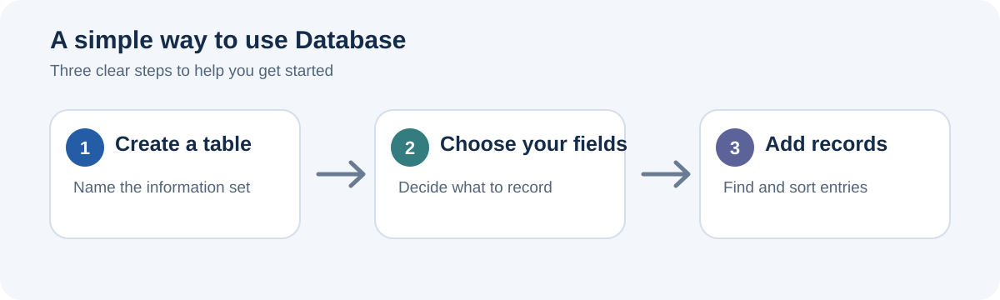</a></td><td><a href="docs/media/guide-database.svg">Open SVG</a></td></tr>
<tr><td><strong>Decks — product guide diagram</strong></td><td><a href="docs/media/guide-decks.svg">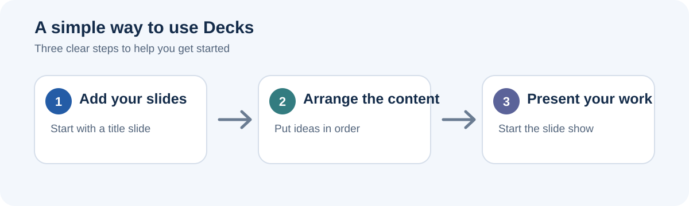</a></td><td><a href="docs/media/guide-decks.svg">Open SVG</a></td></tr>
<tr><td><strong>Forms — product guide diagram</strong></td><td><a href="docs/media/guide-forms.svg">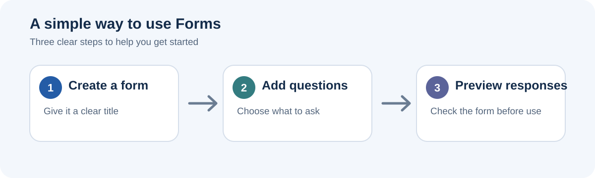</a></td><td><a href="docs/media/guide-forms.svg">Open SVG</a></td></tr>
<tr><td><strong>Lists — product guide diagram</strong></td><td><a href="docs/media/guide-lists.svg">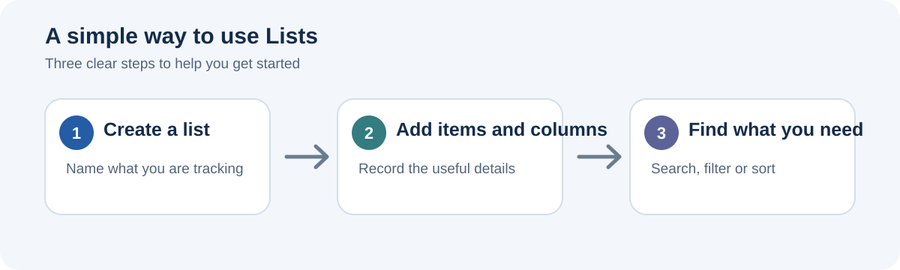</a></td><td><a href="docs/media/guide-lists.svg">Open SVG</a></td></tr>
<tr><td><strong>Notes — product guide diagram</strong></td><td><a href="docs/media/guide-notes.svg">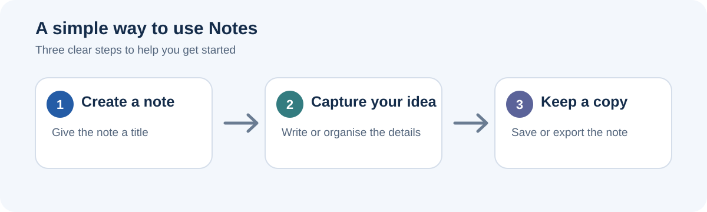</a></td><td><a href="docs/media/guide-notes.svg">Open SVG</a></td></tr>
<tr><td><strong>Pages — product guide diagram</strong></td><td><a href="docs/media/guide-pages.svg">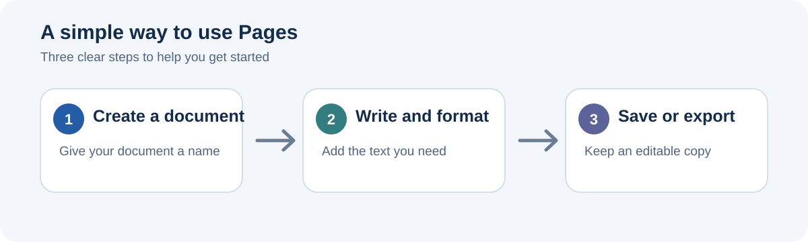</a></td><td><a href="docs/media/guide-pages.svg">Open SVG</a></td></tr>
<tr><td><strong>Planner — product guide diagram</strong></td><td><a href="docs/media/guide-planner.svg">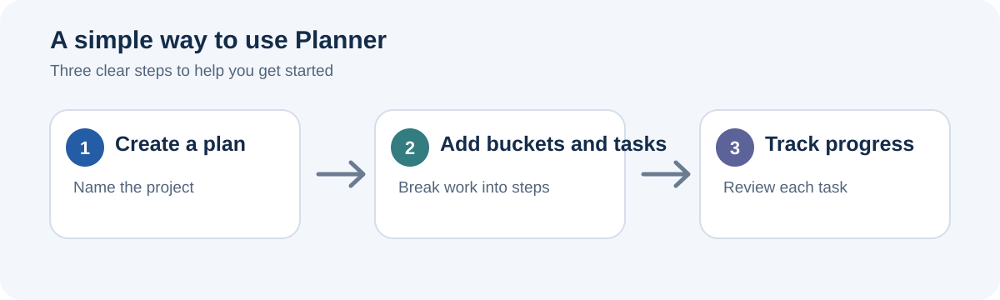</a></td><td><a href="docs/media/guide-planner.svg">Open SVG</a></td></tr>
<tr><td><strong>Sheets — product guide diagram</strong></td><td><a href="docs/media/guide-sheets.svg">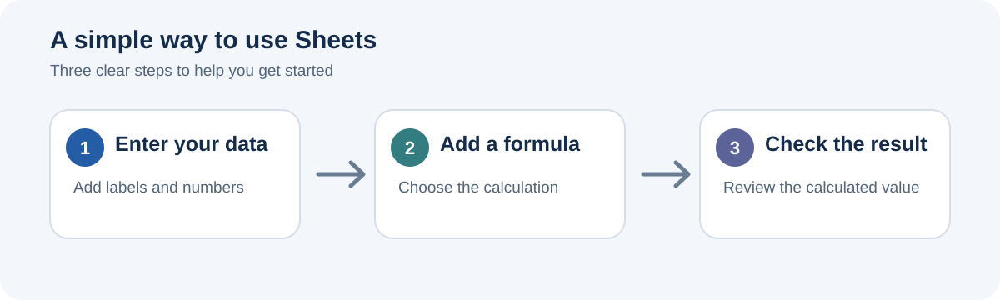</a></td><td><a href="docs/media/guide-sheets.svg">Open SVG</a></td></tr>
<tr><td><strong>To-do — product guide diagram</strong></td><td></td><td><a href="docs/media/guide-to-do.svg">Open SVG</a></td></tr>
<tr><td><strong>Workspace — product guide diagram</strong></td><td><a href="docs/media/guide-workspace.svg">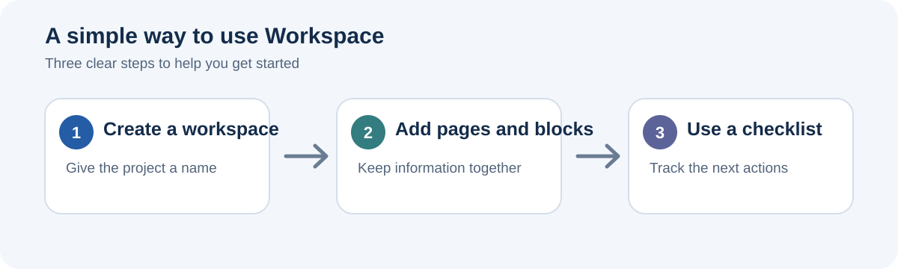</a></td><td><a href="docs/media/guide-workspace.svg">Open SVG</a></td></tr>
</tbody>
</table>

## Asset-library and evidence diagrams (6)

These diagrams describe the asset library, screenshot evidence, review and offline-delivery process.

<table>
<thead><tr><th>Diagram</th><th>Preview — click to open</th><th>File</th></tr></thead>
<tbody>
<tr><td><strong>Asset approval pipeline — Source, rights, quality, metadata, checksum and approval gates.</strong></td><td><a href="docs/media/asset-approval-pipeline.svg">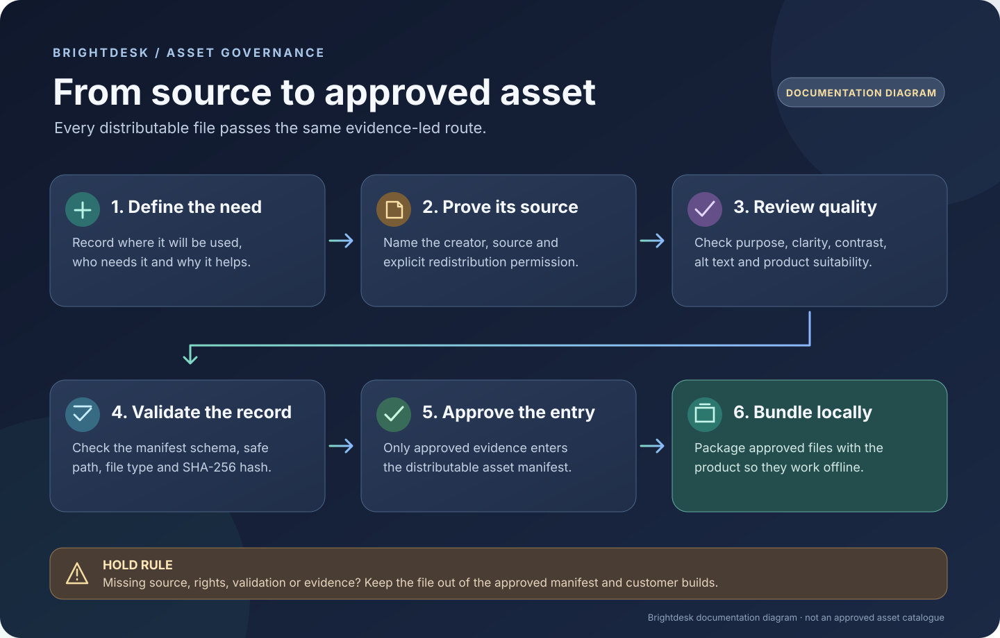</a></td><td><a href="docs/media/asset-approval-pipeline.svg">Open SVG</a></td></tr>
<tr><td><strong>Asset library blueprint — The purpose and boundaries of the shared visual library.</strong></td><td></td><td><a href="docs/media/asset-library-blueprint.svg">Open SVG</a></td></tr>
<tr><td><strong>Offline asset delivery — How approved assets are bundled locally for offline use.</strong></td><td><a href="docs/media/offline-asset-delivery.svg">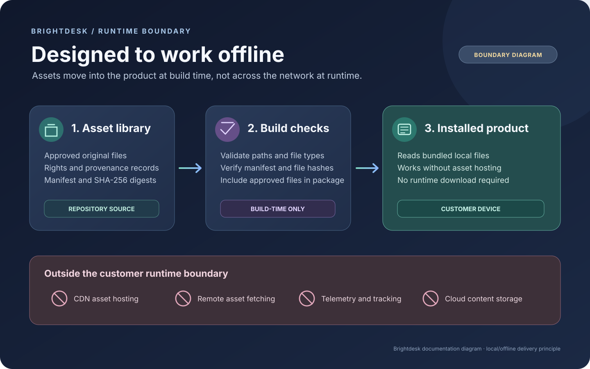</a></td><td><a href="docs/media/offline-asset-delivery.svg">Open SVG</a></td></tr>
<tr><td><strong>Screenshot coverage plan — The 33 planned Suite/product and platform screenshot targets.</strong></td><td></td><td><a href="docs/media/screenshot-coverage-plan.svg">Open SVG</a></td></tr>
<tr><td><strong>Screenshot evidence template — Required build, platform, commit, workflow and capture metadata.</strong></td><td><a href="docs/media/screenshot-evidence-template.svg">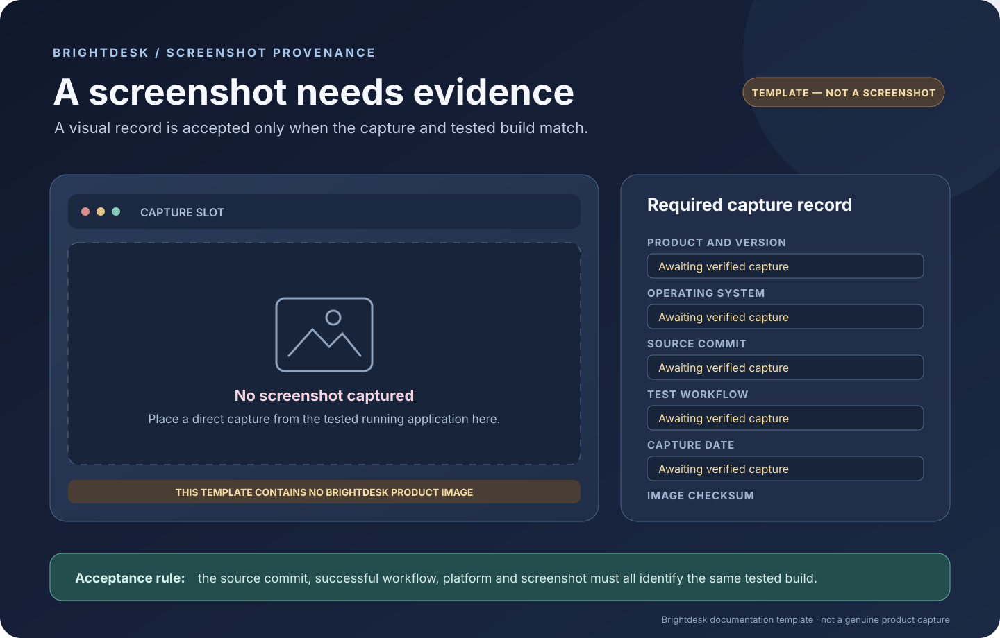</a></td><td><a href="docs/media/screenshot-evidence-template.svg">Open SVG</a></td></tr>
<tr><td><strong>Visual review checklist — Authenticity, legibility, accessibility, product fit and provenance.</strong></td><td><a href="docs/media/visual-review-checklist.svg">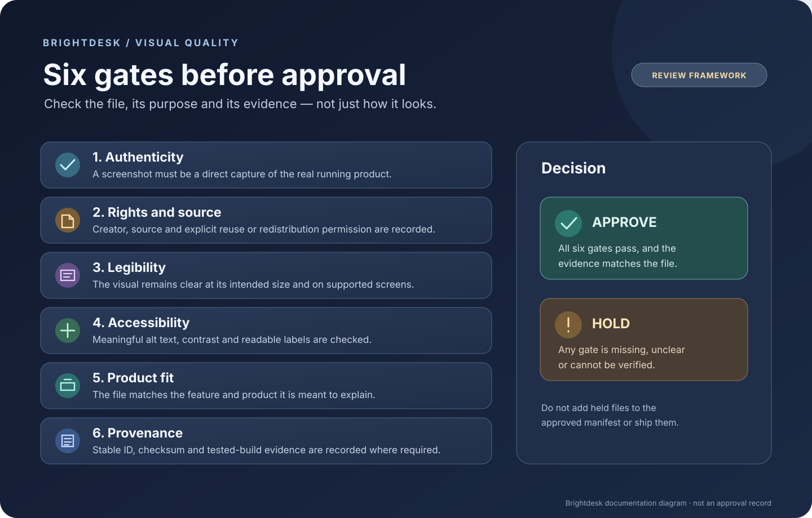</a></td><td><a href="docs/media/visual-review-checklist.svg">Open SVG</a></td></tr>
</tbody>
</table>

## Direct folders and governance

- [All product icon SVGs](assets/concepts/product-icons/)
- [All product illustration SVGs](assets/concepts/product-illustrations/)
- [All documentation SVGs](docs/media/)
- [Asset governance requirements](docs/asset-governance.md)
- [Approved distribution manifest](assets/manifest.json)

All previews link directly to the original SVG file in this repository. The files are stored in Git; the customer products must continue to bundle only assets that have passed approval, rights, provenance and integrity requirements.
