# Brightdesk Assets

**The shared, offline-first home for original Brightdesk visual assets, product screenshots and supporting media.**

This repository is engineering infrastructure for Brightdesk Suite and its ten approved customer products. It is not a customer product, runtime asset server or CDN. Products bundle the approved files they need so that visuals remain available offline.

<p align="center">
  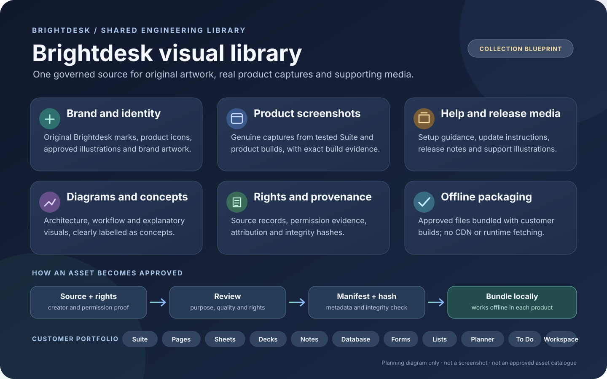
</p>

<p align="center"><em>Collection blueprint — a documentation diagram, not a product screenshot or an approved asset catalogue.</em></p>

## What this library is intended to contain

| Collection | What belongs here |
| --- | --- |
| **Brand and identity** | Original Brightdesk logos and marks, the ten product icons, approved illustrations and brand artwork. |
| **Product screenshots** | Genuine screenshots captured directly from tested Suite and product builds, with exact product, version, platform, source commit and workflow evidence. |
| **Help and release media** | Setup and installation guidance, update instructions, release imagery and support illustrations. |
| **Diagrams and concepts** | Architecture, workflow and explanatory diagrams. Concepts and mock-ups must remain clearly labelled and must never be presented as proof that a feature works. |
| **Rights and provenance** | Creator/source records, explicit permission evidence, attribution requirements and SHA-256 integrity records. |

## Planned product screenshot coverage

The intended customer screenshot set covers the Suite and exactly ten products across the three desktop platforms. The matrix below is a **capture plan**: every cell is still planned, not a claim that a screenshot or tested build already exists.

<p align="center">
  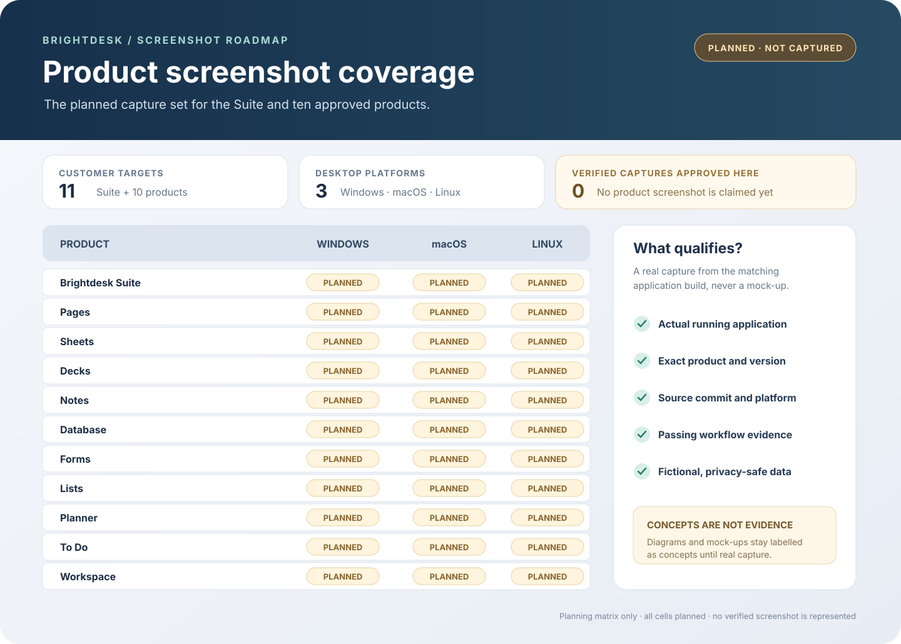
</p>

<p align="center"><em>Capture roadmap — all 33 targets are planned; no verified product screenshot is represented.</em></p>

A screenshot can be approved only after it is captured from the actual running application and tied to the exact build that passed its relevant workflow. A hand-drawn interface, design preview, mock-up or promotional composition is not a verified screenshot.

## Supporting library diagrams

The following additional diagrams explain how assets are reviewed and delivered. They are **documentation only**: none is a distributable product asset, genuine product screenshot, or entry in `assets/manifest.json`.

| Diagram | What it explains |
| --- | --- |
| [Asset approval pipeline](docs/media/asset-approval-pipeline.svg) | Source, rights, quality, metadata, checksum, approval and local bundling gates. |
| [Offline asset delivery](docs/media/offline-asset-delivery.svg) | Build-time validation and local packaging, with remote runtime fetching outside the customer boundary. |
| [Screenshot evidence template](docs/media/screenshot-evidence-template.svg) | Required build, platform, commit, workflow and capture metadata. The preview area is intentionally blank. |
| [Visual review checklist](docs/media/visual-review-checklist.svg) | Authenticity, rights, legibility, accessibility, product fit and provenance. |

These diagrams support the library's governance and engineering workflow. They do not replace actual application captures or evidence from tested builds.

## Product guide workflow diagrams

Ten original Brightdesk workflow illustrations are stored in the shared library, one for each approved customer product. They explain simple three-step product workflows for Help content; **they are documentation diagrams, not screenshots of the running applications, not verified UI evidence and not approved distributable product artwork**.

| Product | Workflow illustration |
| --- | --- |
| Pages | [guide-pages.svg](docs/media/guide-pages.svg) |
| Sheets | [guide-sheets.svg](docs/media/guide-sheets.svg) |
| Decks | [guide-decks.svg](docs/media/guide-decks.svg) |
| Notes | [guide-notes.svg](docs/media/guide-notes.svg) |
| Database | [guide-database.svg](docs/media/guide-database.svg) |
| Forms | [guide-forms.svg](docs/media/guide-forms.svg) |
| Lists | [guide-lists.svg](docs/media/guide-lists.svg) |
| Planner | [guide-planner.svg](docs/media/guide-planner.svg) |
| To Do | [guide-to-do.svg](docs/media/guide-to-do.svg) |
| Workspace | [guide-workspace.svg](docs/media/guide-workspace.svg) |

Source and file-level provenance are recorded in [product guide illustration provenance](docs/product-guide-illustrations.md). All ten remain documentation-only; they are not added to `assets/manifest.json`.

## Current repository status

- The versioned asset manifest, JSON Schema and local validator are implemented.
- `assets/manifest.json` is intentionally empty. **There are currently no approved distributable images, artwork or product screenshots in the asset collection.**
- The sixteen SVGs in `docs/media/` are README, governance and product-guide documentation diagrams. They explain the collection, capture plan, review/delivery boundaries and simple three-step product workflows; they are not customer product assets, genuine product screenshots or entries in the approved manifest.
- Real product screenshots will be added only when matching tested-build evidence is available. Concepts will remain labelled as concepts until replaced by real captures.

This distinction is deliberate: the README can explain what the repository is being built to contain without pretending that uncreated or unverified assets already exist.

## Ownership boundaries

- **Brightdesk-Assets:** approved visual files, manifest records, source and rights evidence, attribution and asset validation.
- **Brightdesk-Design-System:** design tokens, reusable UI components and design contracts.
- **Brightdesk-Fonts:** font binaries, provenance, licensing and redistribution/embedding permissions.
- **Brightdesk-Type-Preview:** local font-preview contracts and generation.

## Approval requirements

Every distributable asset needs a stable ID and path, a clear purpose and alt text, intended product assignment, source/creator details, documented rights evidence, explicit redistribution approval, explicit bundling permission and a SHA-256 digest.

Do not infer permission from a public URL or from the fact that a file exists in a repository. Original or generated artwork also needs a documented rights basis. If provenance or permission is unclear, keep it out of the approved manifest and out of customer builds.

For verified screenshots, record the product, platform, app version, exact source commit, tested workflow name and HTTPS link to matching workflow evidence. The source commit and workflow must refer to the same tested build.

See [asset governance](docs/asset-governance.md) and the [asset manifest schema](schemas/asset-manifest.schema.json) before adding distributable files.

## Offline and branding requirements

Use original Brightdesk implementation and branding only. Do not copy Microsoft or Adobe logos, proprietary artwork, source code or trade dress. Microsoft design guidance may be used as a quality reference only. Do not add Adobe applications, services, integrations or assets.

Customer products must bundle approved assets locally. Do not add runtime network fetching, external asset hosting, telemetry, cloud content or a Brightdesk-Services dependency.

## Validation

Use Node.js **24.22.2**. No runtime dependencies are required.


`npm test` also checks that every documentation SVG has an accessible title and description, balanced XML elements, and no external image or script dependency.
```sh
npm test
npm run validate
```

## Original product concept illustrations

An initial set of ten original, editable SVG illustrations is now included—one for each approved customer product. These are **concept artwork**, not screenshots or proof of implemented features. Browse the [complete illustration library](assets/concepts/product-illustrations/) and its [usage guide](assets/concepts/README.md).

| Product | Original concept illustration |
| --- | --- |
| **Pages** | 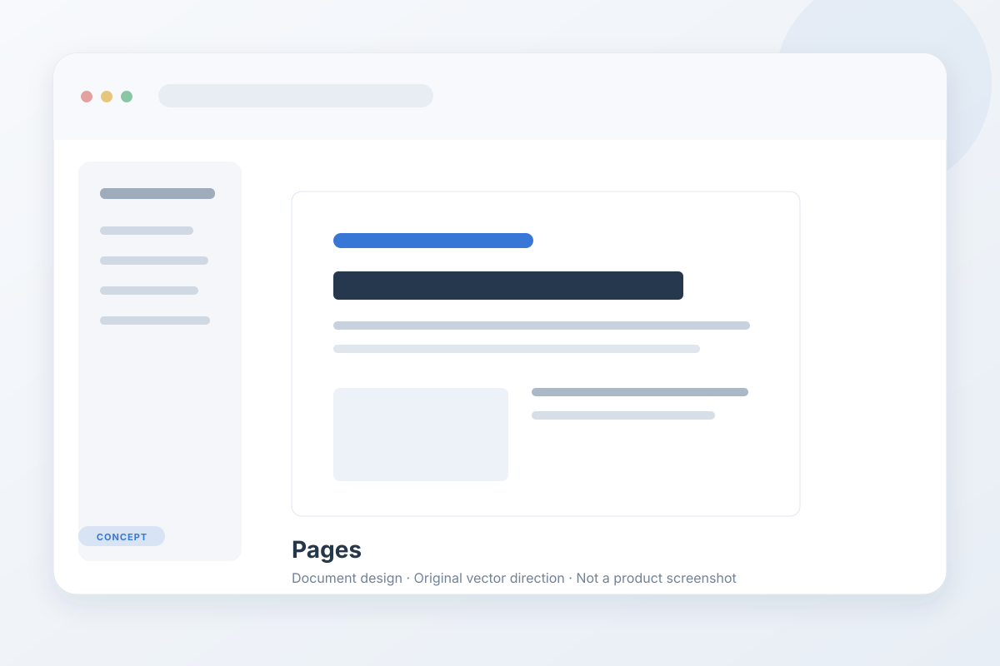 |
| **Sheets** | 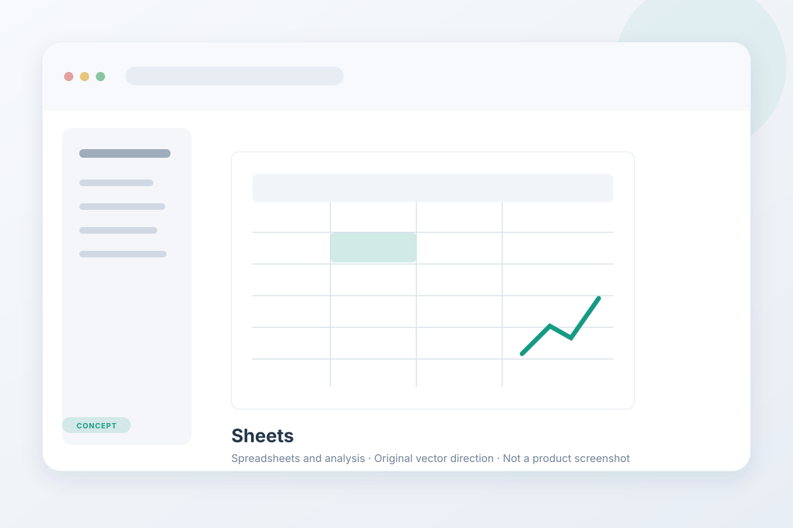 |
| **Decks** | 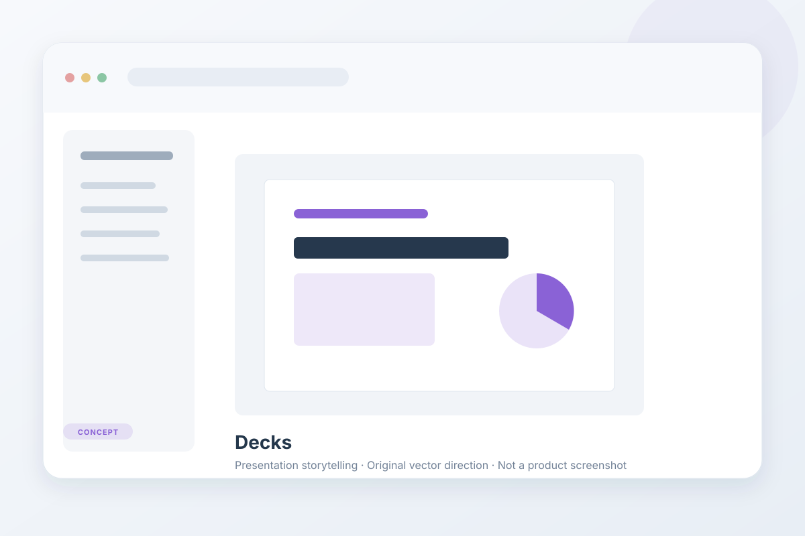 |
| **Notes** | 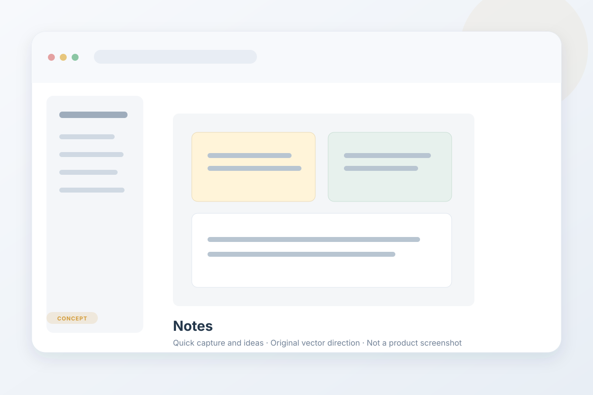 |
| **Database** | 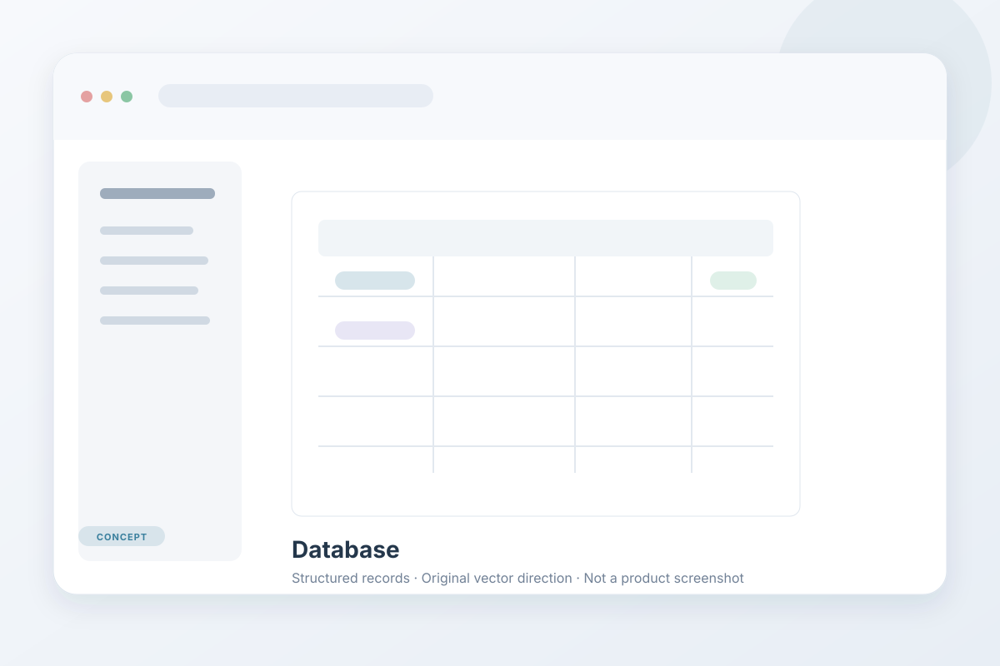 |
| **Forms** | 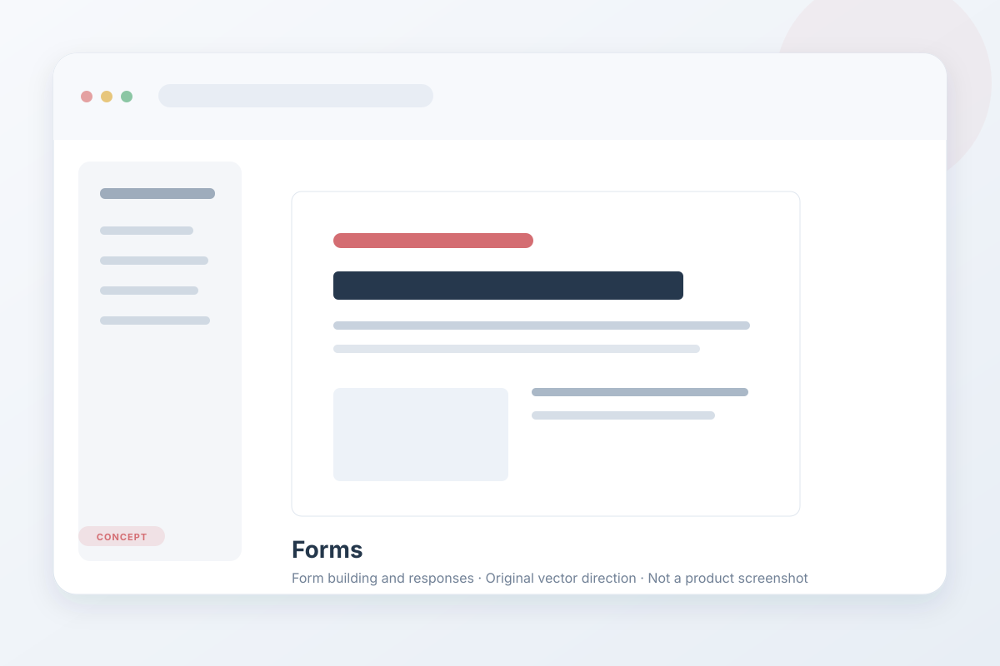 |
| **Lists** | 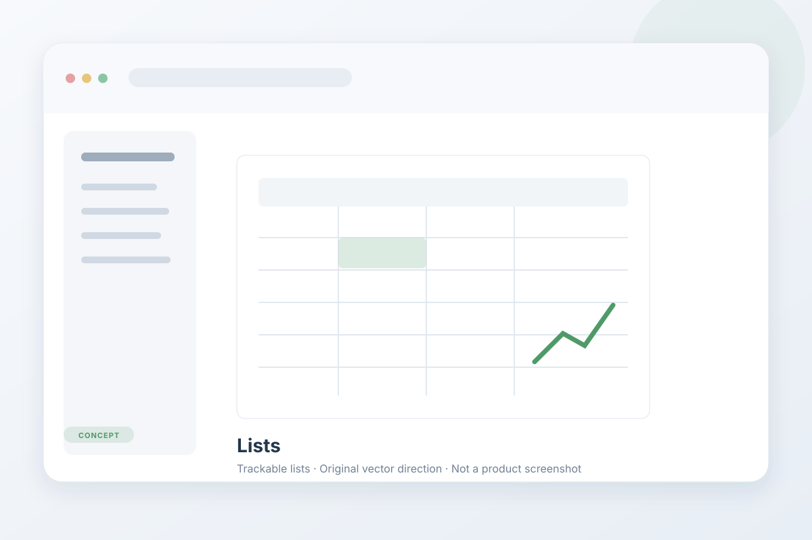 |
| **Planner** | 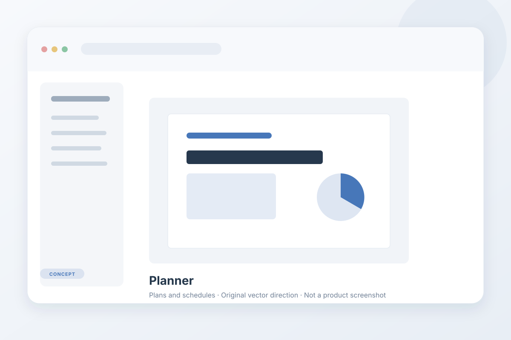 |
| **To Do** | 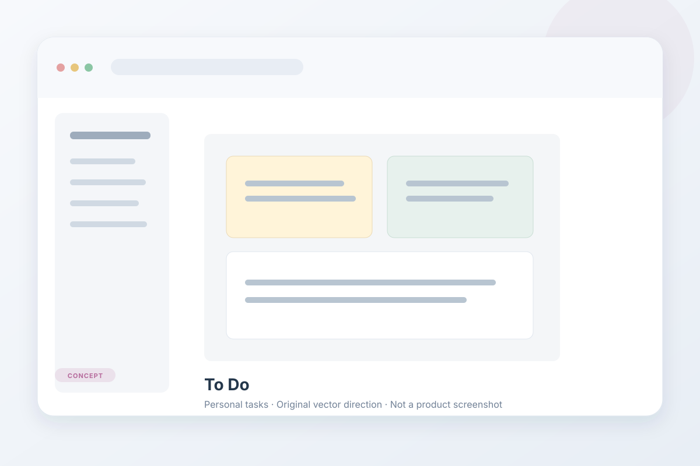 |
| **Workspace** | 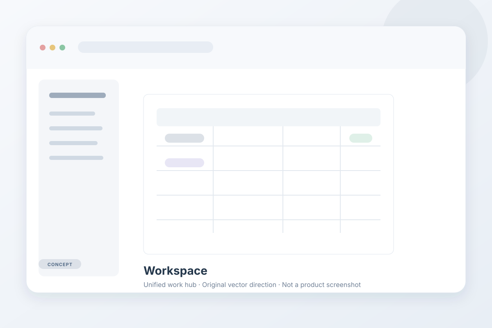 |

The screenshot capture plan remains separate. Genuine product screenshots will be added only when captured from actual running builds and matched to workflow evidence. Concept artwork is not included in the approved distributable manifest.


## Original product icon concepts

A second exploration set adds ten original, editable SVG icon concepts for the ten approved products. These are **concepts for design review**, not approved final product icons or screenshots. Each icon is documented in the [product icon concept guide](assets/concepts/product-icons/README.md).

| Product | Icon concept |
| --- | --- |
| **Pages** |  |
| **Sheets** |  |
| **Decks** |  |
| **Notes** |  |
| **Database** |  |
| **Forms** | 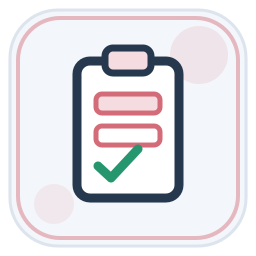 |
| **Lists** |  |
| **Planner** |  |
| **To Do** |  |
| **Workspace** |  |

Keep these concepts out of customer builds and the approved asset manifest until design approval and full provenance, rights, redistribution, bundling and checksum records are complete.
