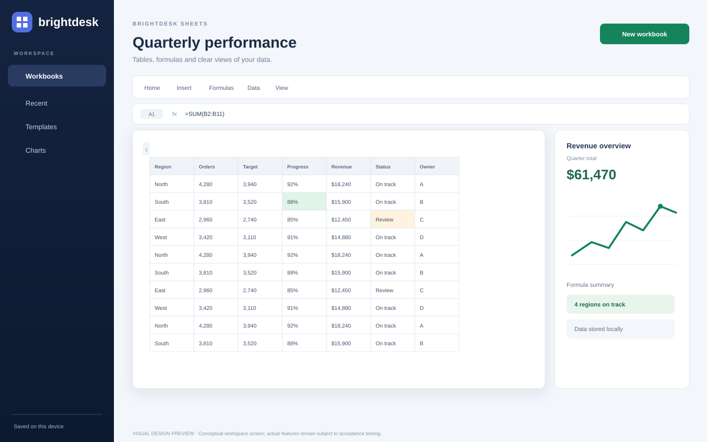
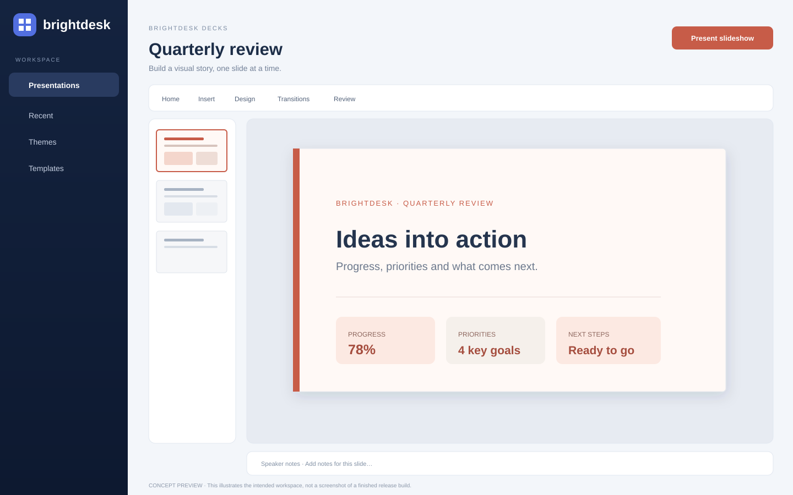
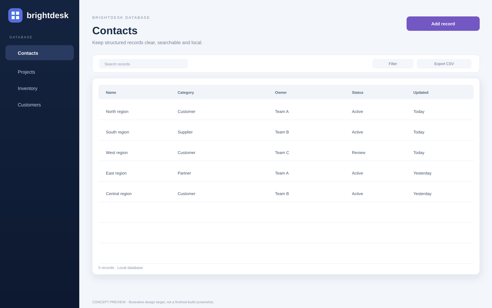
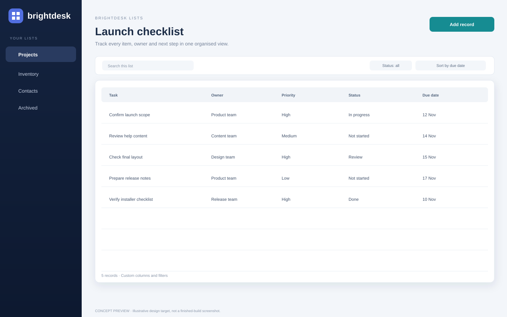
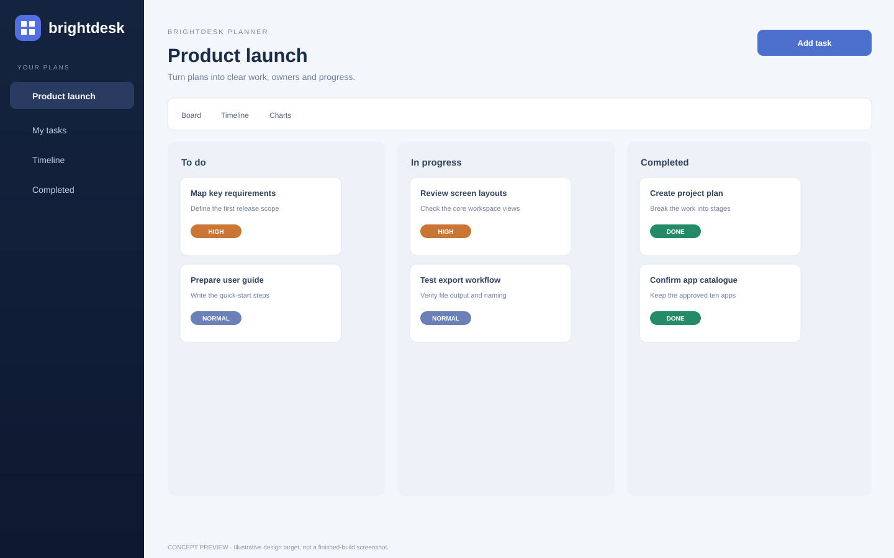
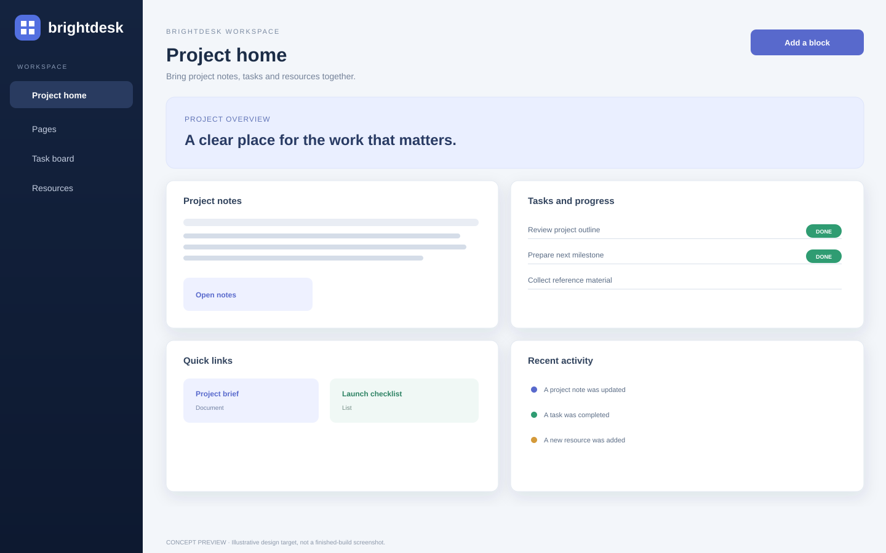

# Brightdesk Assets

<p align="center"></p>

**The shared, offline-first library for Brightdesk identity, product artwork, help diagrams and verified release imagery.**

This repository supports Brightdesk Suite and its ten approved customer products. It is engineering infrastructure, not a customer product, runtime asset server or CDN. Product builds must bundle approved files locally.

**See the artwork below:** the README now displays all ten product workspace previews and application icons. [Open the complete SVG asset gallery](ASSET-GALLERY.md) to browse all **48 SVG files**, including social banners and documentation diagrams.

## The ten product artwork previews

These are the actual source-owned SVG preview files copied unchanged from the product repositories. They are useful for reviewing the intended visual direction and artwork currently held in this library. **They are not screenshots of running applications and do not prove that the pictured interface or features are implemented.** Select any large preview to open its original SVG.

<table>
<tbody>
<tr>
<td align="center" valign="top" width="50%">
<h3>Pages</h3>
<a href="assets/product-previews/pages.svg"></a>
<p></p>
<p><a href="assets/product-previews/pages.svg">Open workspace preview</a> · <a href="assets/product-icons/pages.svg">Open product icon</a></p>
</td>
<td align="center" valign="top" width="50%">
<h3>Sheets</h3>
<a href="assets/product-previews/sheets.svg"></a>
<p></p>
<p><a href="assets/product-previews/sheets.svg">Open workspace preview</a> · <a href="assets/product-icons/sheets.svg">Open product icon</a></p>
</td>
</tr>
<tr>
<td align="center" valign="top" width="50%">
<h3>Decks</h3>
<a href="assets/product-previews/decks.svg"></a>
<p></p>
<p><a href="assets/product-previews/decks.svg">Open workspace preview</a> · <a href="assets/product-icons/decks.svg">Open product icon</a></p>
</td>
<td align="center" valign="top" width="50%">
<h3>Notes</h3>
<a href="assets/product-previews/notes.svg"></a>
<p></p>
<p><a href="assets/product-previews/notes.svg">Open workspace preview</a> · <a href="assets/product-icons/notes.svg">Open product icon</a></p>
</td>
</tr>
<tr>
<td align="center" valign="top" width="50%">
<h3>Database</h3>
<a href="assets/product-previews/database.svg"></a>
<p></p>
<p><a href="assets/product-previews/database.svg">Open workspace preview</a> · <a href="assets/product-icons/database.svg">Open product icon</a></p>
</td>
<td align="center" valign="top" width="50%">
<h3>Forms</h3>
<a href="assets/product-previews/forms.svg"></a>
<p></p>
<p><a href="assets/product-previews/forms.svg">Open workspace preview</a> · <a href="assets/product-icons/forms.svg">Open product icon</a></p>
</td>
</tr>
<tr>
<td align="center" valign="top" width="50%">
<h3>Lists</h3>
<a href="assets/product-previews/lists.svg"></a>
<p></p>
<p><a href="assets/product-previews/lists.svg">Open workspace preview</a> · <a href="assets/product-icons/lists.svg">Open product icon</a></p>
</td>
<td align="center" valign="top" width="50%">
<h3>Planner</h3>
<a href="assets/product-previews/planner.svg"></a>
<p></p>
<p><a href="assets/product-previews/planner.svg">Open workspace preview</a> · <a href="assets/product-icons/planner.svg">Open product icon</a></p>
</td>
</tr>
<tr>
<td align="center" valign="top" width="50%">
<h3>To Do</h3>
<a href="assets/product-previews/todo.svg"></a>
<p></p>
<p><a href="assets/product-previews/todo.svg">Open workspace preview</a> · <a href="assets/product-icons/todo.svg">Open product icon</a></p>
</td>
<td align="center" valign="top" width="50%">
<h3>Workspace</h3>
<a href="assets/product-previews/workspace.svg"></a>
<p></p>
<p><a href="assets/product-previews/workspace.svg">Open workspace preview</a> · <a href="assets/product-icons/workspace.svg">Open product icon</a></p>
</td>
</tr>
</tbody>
</table>

## What is in the library

| Collection | Current contents |
| --- | --- |
| **Brightdesk identity** | Original Suite wordmark and geometric brand mark. |
| **Product application icons** | The actual product icon SVGs copied unchanged from all ten product repositories. |
| **Product workspace previews** | Product-specific workspace previews copied from their source repositories. These are design previews or proposed concepts, not verified screenshots. |
| **Product social banners** | Original social/metadata preview banners from all ten product repositories. |
| **Help and governance diagrams** | Ten product-guide workflow diagrams and six asset-library, offline-delivery and screenshot-evidence diagrams. |
| **Verified product screenshots** | Not yet available. Genuine screenshots must be captured from tested running builds and tied to the exact workflow evidence. |

## Browse the artwork

The [complete SVG asset gallery](ASSET-GALLERY.md) displays and links to every image in one place. It is organised into Brightdesk identity, product icons, product workspace previews, social banners and documentation diagrams.

The [source asset catalog](docs/source-asset-catalog.md) records each mirrored image's source repository, original path and source Git blob SHA. The copied icons, previews and banners are unchanged from those sources.

## Screenshot status

**No verified application screenshots are available yet.** The screenshot coverage plan includes Brightdesk Suite and the ten approved products across Windows, macOS and Linux. All 33 product/platform targets remain planned until captured.

A product preview, illustration, mock-up or social banner is **not** a genuine application screenshot. A verified screenshot must be captured from the actual running product build and recorded with the product, platform, app version, exact source commit, tested workflow and matching successful workflow evidence.

See [the screenshot coverage plan](docs/media/screenshot-coverage-plan.svg), [evidence template](docs/media/screenshot-evidence-template.svg) and [product guide illustration register](docs/product-guide-illustrations.md).

## Supporting documentation SVGs

The following 16 SVGs are original help, workflow and governance diagrams. They are documentation illustrations, not screenshots of running product builds.

| Diagram | File |
| --- | --- |
| Asset approval pipeline | [docs/media/asset-approval-pipeline.svg](docs/media/asset-approval-pipeline.svg) |
| Asset library blueprint | [docs/media/asset-library-blueprint.svg](docs/media/asset-library-blueprint.svg) |
| Product guide — Database | [docs/media/guide-database.svg](docs/media/guide-database.svg) |
| Product guide — Decks | [docs/media/guide-decks.svg](docs/media/guide-decks.svg) |
| Product guide — Forms | [docs/media/guide-forms.svg](docs/media/guide-forms.svg) |
| Product guide — Lists | [docs/media/guide-lists.svg](docs/media/guide-lists.svg) |
| Product guide — Notes | [docs/media/guide-notes.svg](docs/media/guide-notes.svg) |
| Product guide — Pages | [docs/media/guide-pages.svg](docs/media/guide-pages.svg) |
| Product guide — Planner | [docs/media/guide-planner.svg](docs/media/guide-planner.svg) |
| Product guide — Sheets | [docs/media/guide-sheets.svg](docs/media/guide-sheets.svg) |
| Product guide — To Do | [docs/media/guide-to-do.svg](docs/media/guide-to-do.svg) |
| Product guide — Workspace | [docs/media/guide-workspace.svg](docs/media/guide-workspace.svg) |
| Offline asset delivery | [docs/media/offline-asset-delivery.svg](docs/media/offline-asset-delivery.svg) |
| Screenshot coverage plan | [docs/media/screenshot-coverage-plan.svg](docs/media/screenshot-coverage-plan.svg) |
| Screenshot evidence template | [docs/media/screenshot-evidence-template.svg](docs/media/screenshot-evidence-template.svg) |
| Visual review checklist | [docs/media/visual-review-checklist.svg](docs/media/visual-review-checklist.svg) |

## Current approval status

- `assets/manifest.json` is intentionally empty.
- Mirroring artwork from the product repositories does **not** automatically approve it for redistribution or inclusion in customer installers.
- Every distributable asset still needs a stable ID and path, purpose, alt text, product assignment, source/creator details, rights evidence, explicit redistribution approval, explicit bundling permission and SHA-256 integrity record.
- Keep unapproved artwork out of customer builds. Do not infer rights or licence permission from a file's presence in GitHub.

Read [asset governance](docs/asset-governance.md) and the [asset manifest schema](schemas/asset-manifest.schema.json) before approving or packaging any file.

## Ownership boundaries

- **Brightdesk-Assets:** shared visual files, source/provenance records, approved manifest and asset validation.
- **Brightdesk-Design-System:** design tokens, reusable UI components and design contracts.
- **Brightdesk-Fonts:** font binaries, provenance, licensing and redistribution/embedding permissions.
- **Brightdesk-Type-Preview:** local font-preview contracts and generation.

## Offline and branding requirements

Use original Brightdesk branding and artwork. Do not copy Microsoft or Adobe logos, proprietary artwork, source code or trade dress. Microsoft design guidance may be used as a quality reference only. Do not add Adobe applications, services, integrations or assets.

Customer products must bundle approved assets locally. Do not add runtime network fetching, external asset hosting, telemetry, cloud content or a Brightdesk-Services dependency.

## Validation

Use Node.js **24.22.2**. No runtime dependencies are required.

```sh
npm test
npm run validate
```
